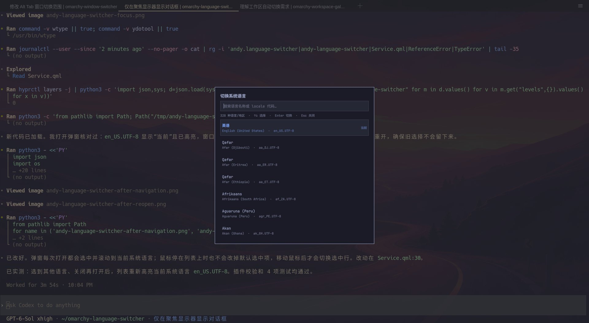

# Omarchy Language Switcher

简体中文 | [English](README.md)



[预览图来源](https://x.com/manateelazycat/status/2103848803740893201)

**许可证：GPL 3.0**

Omarchy Shell 插件。点击任务栏右侧的语言图标，会在当前聚焦的显示器中央打开与 Omarchy 菜单同色系的搜索框，列表默认选中当前系统语言。输入中文、英文、本地语言名称或 locale 代码，使用方向键选择，按 Enter 切换系统语言；Esc 关闭。

插件从系统的 `/usr/share/i18n/SUPPORTED` 读取所有 UTF-8 locale。选择未生成的 locale 时，会通过 Omarchy 的图形管理员授权生成该 locale，再用 `localectl` 设置系统 `LANG`。搜索框在确认后立即收起，处理结果显示在同一块显示器中央；成功后提示注销并重新登录。它切换的是系统 locale，不改变键盘布局或输入法。

## 安装

```bash
git clone https://github.com/manateelazycat/omarchy-language-switcher.git
cd omarchy-language-switcher
./install.sh
```

请以普通用户运行安装脚本。脚本会通过 `sudo` 将可执行 helper 安装到 `/usr/local/libexec/omarchy-language-switcher-helper`，文件归 root 所有、权限为 `0755`；同时写入 root 拥有的 `.receipt` 文件，记录 helper 的 SHA-256 摘要。插件读取语言列表和切换语言时都使用这份安装后的文件；管理员授权不会执行用户可写的项目克隆目录中的代码。

安装脚本还会把项目目录链接到 `~/.config/omarchy/plugins/andy.language-switcher`，为 `shell.json` 创建不会覆盖已有文件的独立备份，启用插件并把图标加入任务栏右侧。项目目录需要保留在原位置。更新项目代码后，请重新运行 `./install.sh` 更新系统中的 helper。

如果 helper 路径已有文件，却没有匹配的安装记录，安装脚本会拒绝覆盖。这也适用于新增安装记录之前的旧版本。`1205894` 版本 helper 的 SHA-256 摘要是 `a1a646f110f96b12f5514b6635c0221efdf67b22d0caea3e89eb3798eb17bb13`。如果你安装过该版本，先用 `sha256sum /usr/local/libexec/omarchy-language-switcher-helper` 核对摘要，再用 `sudo rm -- /usr/local/libexec/omarchy-language-switcher-helper` 删除已确认的旧 helper，最后重新运行 `./install.sh`。如果摘要不同或不确定文件来源，请先查明情况，不要删除。安装脚本不会自动接管或覆盖没有记录的文件。

## 使用

点击任务栏语言图标，或运行 `omarchy-shell andy.language-switcher show` 打开搜索框。用 `↑`、`↓` 选择，按 `Enter` 切换；按 `Esc` 关闭。

搜索框支持输入法、文本选区、撤销和重做，以及 `Ctrl+V`、`Shift+Insert`、右键菜单和鼠标中键（主选区）粘贴。只有主动粘贴时才会在独立进程中读取剪贴板，限制为 4 KiB 和 1 秒总耗时。超大、未完成或无效 UTF-8 传输不会修改搜索内容；换行和制表符转换为空格。继续编辑或关闭窗口会取消未完成的粘贴。

## 卸载

```bash
./uninstall.sh
```

卸载脚本会移除 Omarchy 插件链接，并通过 `sudo` 删除 root 拥有的 helper 和安装记录。对于没有匹配记录或内容已变化的 helper，卸载脚本会拒绝删除。本地项目目录不会被删除。

## 运行要求

Omarchy Shell、Hyprland、Python 3、`wl-clipboard` 和 GNU coreutils（用于粘贴）、`locale-gen`、`localectl`、`pkexec`、`sudo`，以及可用的 Polkit 图形授权代理。安装脚本还使用 `jq`。语言资源是否完整取决于已安装的软件翻译包。

## 开发检查

```bash
python -m unittest discover -s tests -p 'test_*.py'
bash tests/test_helper_installation.sh
python tests/check_theme.py
python tests/check_search.py
omarchy plugin validate .
```

主题检查需要运行中的 Wayland 会话。搜索检查使用 Qt 离屏平台和仅用于测试的 C++ 探针，需要 C++ 编译器、`pkg-config` 和 Qt 6 开发工具；它验证实际控件的剪贴板访问、键盘和输入法事件、编辑、滚动、粘贴入口及取消行为，不读取桌面剪贴板，也不修改系统语言。剪贴板读取测试使用临时进程验证大小限制、停滞和持续传输、总超时及进程清理。

## 协议

本项目采用 GNU 通用公共许可证第 3 版（GPL 3.0，SPDX 标识符：`GPL-3.0-only`）。完整条款见 [LICENSE](LICENSE)。
